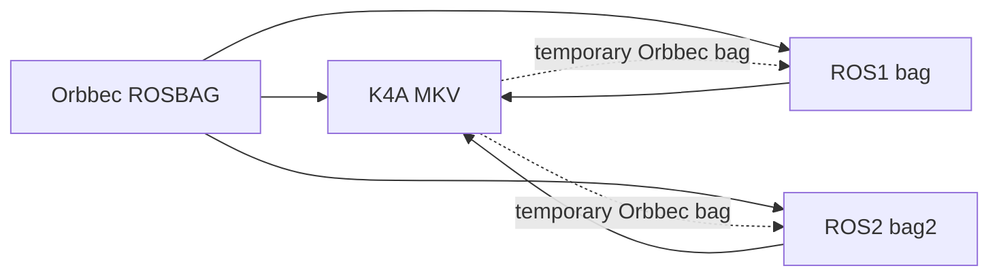

<h1 align="center">bag2mkv</h1>

<p align="center">
  <strong>Lossless RGB-D conversion between Orbbec ROSBAG, Azure Kinect MKV, and ROS 1/2 bags.</strong>
</p>

<p align="center">
  <a href="README.md">English</a> ·
  <a href="README.zh-CN.md">简体中文</a>
</p>

<p align="center">
  
  
  
  
  
  
  
</p>

> **v0.6.0** — Windows x64 CLI + GUI; Linux x86_64 CLI. ROS 1/2 conversion is available from the CLI on both platforms.
> The GUI is Windows-only.

`bag2mkv` is a focused, verifiable conversion toolkit for RGB-D recordings. It does **not** re-encode color, filter depth, align streams, or pretend a generic video muxer is a Kinect recorder. It preserves what the source actually contains, and gives you a way to prove it.

---

## Table of contents

- [Why bag2mkv](#why-bag2mkv)
- [Conversion matrix](#conversion-matrix)
- [Lossless contract](#lossless-contract)
- [Quick start](#quick-start)
- [Command line](#command-line)
- [ROS 1 / ROS 2](#ros-1--ros-2)
- [GUI](#gui)
- [Architecture](#architecture)
- [Format notes](#format-notes)
- [Verification](#verification)
- [Limitations and roadmap](#limitations-and-roadmap)
- [FAQ](#faq)
- [Contributing](#contributing)
- [License](#license)
- [Repository description](#repository-description)

---

## Why bag2mkv

Azure Kinect recordings (`.mkv`) and Orbbec ROSBAG recordings (`.bag`) both contain synchronized color, depth, IR, and metadata, but they speak different container dialects. Generic converters usually take the easy route: decode everything to video, drop depth precision, or silently resize frames.

`bag2mkv` takes the harder route:

- **Color is never re-encoded.** Original MJPEG bytes are preserved in a dedicated K4A track. BGRA is a deterministic decode for players that need it.
- **Depth is bit-exact.** Only the required 16-bit little-endian → big-endian representation change is applied by the K4A writer.
- **Metadata survives.** Device information, stream profiles, properties, frame timestamps, frame numbers, and raw metadata are written as MKV attachments.
- **Writes are atomic.** Output is written to `.tmp`, then renamed only after a successful close.
- **The result is verifiable.** `verify` independently compares the source bag and the produced MKV; it does not trust the converter's own counters.

No camera is required. `k4a_record_create(device = nullptr)` is enough to produce a valid K4A recording.

---

## Conversion matrix

| # | Input | Output | Command | Status |
|---|---|---|---|---|
| 1 | Orbbec ROSBAG `#ROSBAG V2.0` | K4A-compatible MKV | `convert` | Available |
| 2 | K4A MKV | Orbbec ROSBAG | `mkv2bag` | Available |
| 3 | Orbbec ROSBAG | Standard ROS1 `.bag` | `ros1` | Available |
| 4 | Orbbec ROSBAG | ROS2 sqlite3 bag directory | `ros2` | Available |
| 5 | Standard ROS1 `.bag` | K4A-compatible MKV | `ros1mkv` | Available |
| 6 | ROS2 sqlite3 bag directory | K4A-compatible MKV | `ros2mkv` | Available |
| 7 | K4A MKV | ROS1 `.bag` | `mkv2ros1` | Available |
| 8 | K4A MKV | ROS2 sqlite3 bag directory | `mkv2ros2` | Available |

> `mkv2ros1` / `mkv2ros2` currently go through a temporary Orbbec bag. The output is correct; the extra disk I/O is a known implementation detail, not a format limitation.

**Not a supported path:** arbitrary ROS image resolutions, IMU streams, or ROS2 MCAP storage. See [Limitations and roadmap](#limitations-and-roadmap).

---

## Lossless contract

| Data | Guarantee | Implementation |
|---|---|---|
| Color | No JPEG/MPEG re-encode | Original MJPEG bytes copied to `ORIGINAL_COLOR_MJPG`; BGRA is a deterministic decode |
| Depth | Bit-exact 16-bit values | Only LE → BE byte order is changed by the K4A writer |
| IR | Bit-exact 16-bit values | `mono16` / `16UC1` written as K4A `IR16` |
| Timestamps | Microsecond precision | K4A device timestamps in µs |
| Frame identity | Preserved | `header.seq`, `frame_id`, frame `number`, raw metadata, `pixel_bit_size` |
| Device metadata | Preserved where available | MKV attachments: calibration, profiles, properties, manifest/JSONL |
| Output safety | No partial “success” | Write `.tmp`; remove on failure; rename after close |

### A note on “lossless”

Lossless means **no pixel re-encoding and no depth alteration** inside the supported container modes. K4A only accepts a fixed set of color/depth resolutions; inputs outside those modes are rejected instead of silently resized.

For JPEG-compressed ROS color, `--color bgra` decodes to BGRA. Use `--color mjpg` when the compressed JPEG bitstream itself must be preserved in the K4A color track.

---

## Quick start

### Windows release

Download the latest Windows x64 package from the [Releases](https://github.com/Erik-Lin/bag2mkv/releases) page, unzip it, and run:

```powershell
.\bag2mkv.exe --version
.\bag2mkv.exe --help
```

The package is self-contained apart from the bundled K4A/Orbbec runtime DLLs; VC++ runtime DLLs are included.

### Linux release

Download the Linux x86_64 CLI package and run:

```bash
tar -xzf bag2mkv-v0.6.0-linux-x86_64-cli.tar.gz
./bag2mkv-v0.6.0-linux-x86_64-cli/bin/bag2mkv --version
```

Requirements: x86_64 Linux with glibc 2.28+ and libstdc++6. The package bundles the Orbbec K4A Wrapper libraries and uses an `LD_LIBRARY_PATH` wrapper, so no system K4A SDK installation is needed.

### Build from source

Requirements:

- Windows 10/11 x64
- Visual Studio 2022 (MSVC) with the Windows 10/11 SDK
- CMake 3.16+
- The repository's `azurekinectsdk/` directory (headers + `.lib` + runtime DLLs)

```powershell
cmake -S . -B build -G "Visual Studio 17 2022" -A x64
cmake --build build --config Release
ctest --test-dir build -C Release --output-on-failure
```

Outputs:

```text
build\Release\bag2mkv.exe
build\Release\bag2mkv-gui.exe
```

### Linux build from source

Requirements:

- x86_64 Linux, CMake 3.16+, GCC 9+ or Clang 10+
- Orbbec K4A Wrapper for Linux (headers + `.so` files)

```bash
# Extract the Orbbec Linux SDK, e.g. to ./k4a-wrapper
cmake -S . -B build-linux \
  -DCMAKE_BUILD_TYPE=Release \
  -DBUILD_GUI=OFF \
  -DK4A_ROOT="$PWD/k4a-wrapper"
cmake --build build-linux --parallel
ctest --test-dir build-linux --output-on-failure
```

Output:

```text
build-linux/bag2mkv
```

The Linux build excludes `bag2mkv-gui`. It uses `stb_image` for JPEG decoding and an internal SHA-256 implementation, so there is no WIC/BCrypt dependency. Runtime still requires the Orbbec K4A Wrapper `.so` files; the release package bundles them.

### First conversions

```powershell
# Inspect an Orbbec bag
.\build\Release\bag2mkv.exe inspect capture.bag

# Orbbec bag -> K4A MKV, preserving original JPEG and verifying
.\build\Release\bag2mkv.exe convert capture.bag -o capture.mkv --color mjpg --verify

# K4A MKV -> Orbbec bag
.\build\Release\bag2mkv.exe mkv2bag capture.mkv -o capture_roundtrip.bag --force

# Orbbec bag -> standard ROS1 bag
.\build\Release\bag2mkv.exe ros1 capture.bag -o capture_ros1.bag --force

# Orbbec bag -> ROS2 sqlite3 bag
.\build\Release\bag2mkv.exe ros2 capture.bag -o capture_ros2 --force
```

---

## Command line

```text
bag2mkv <command> [options]
bag2mkv help <command>
bag2mkv --version
bag2mkv --self-test
```

| Command | Purpose |
|---|---|
| `inspect <bag>` | Show container, device, profiles, properties, frame counts, timestamps |
| `convert <bag> -o <mkv>` | Orbbec bag → K4A MKV |
| `batch <files-or-dir...> --output-dir <dir>` | Convert many bags |
| `verify <bag> <mkv>` | Independently verify frames, timestamps, calibration |
| `mkv2bag <mkv> -o <bag>` | K4A MKV → Orbbec bag |
| `ros1 <bag> -o <bag>` | Orbbec bag → standard ROS1 bag |
| `ros1mkv <bag> -o <mkv>` | Standard ROS1 bag → K4A MKV |
| `ros2 <bag> -o <dir>` | Orbbec bag → ROS2 sqlite3 bag |
| `ros2mkv <dir> -o <mkv>` | ROS2 sqlite3 bag → K4A MKV |
| `mkv2ros1 <mkv> -o <bag>` | K4A MKV → ROS1 bag |
| `mkv2ros2 <mkv> -o <dir>` | K4A MKV → ROS2 sqlite3 bag |

Every command has detailed help:

```powershell
.\build\Release\bag2mkv.exe help convert
.\build\Release\bag2mkv.exe help batch
.\build\Release\bag2mkv.exe help mkv2bag
.\build\Release\bag2mkv.exe help ros1
.\build\Release\bag2mkv.exe help ros2
```

Common options:

```text
--color bgra|mjpg       Color representation (default: bgra)
--no-original-color     Omit ORIGINAL_COLOR_MJPG in BGRA mode
--no-calibration        Do not write calibration.json
--calibration-json FILE Use a known-good K4A calibration
--force                 Overwrite an existing output
--verify                Verify immediately after convert
```

Exit codes: `0` success, `1` conversion/verification failure, `2` usage error, `3` cancelled.

---

## ROS 1 / ROS 2

ROS conversion is deliberately **format-level**: you do not need a ROS installation, `rosbag`, `rosbag2_cpp`, or `rclcpp` on the conversion machine.

### Topics and message types

| Topic | Message | Payload |
|---|---|---|
| `/camera/color/image_raw/compressed` | `sensor_msgs/CompressedImage` | Original JPEG bytes, `format: jpeg` |
| `/camera/color/image_raw` | `sensor_msgs/Image` | Raw color (e.g. `rgb8`, `bgr8`, `bgra8`) |
| `/camera/depth/image_raw` | `sensor_msgs/Image` | `16UC1`, little-endian |
| `/camera/ir/image_raw` | `sensor_msgs/Image` | `16UC1`, little-endian |

### ROS1 output

`ros1` writes a standard ROSBAG V2.0 stream with:

- split connection records (`op=7`) as required by ROS1,
- per-connection index data (`op=4`),
- chunk-info records (`op=6`),
- ROS time fields in message and chunk headers.

The result can be inspected by standard ROS1 tooling and by `rosbags.rosbag1.Reader`.

### ROS2 output

`ros2` creates a normal rosbag2 directory:

```text
capture_ros2/
├─ metadata.yaml
└─ bag_0.db3
```

Messages use CDR with `sensor_msgs/msg/Image` and `sensor_msgs/msg/CompressedImage`. The SQLite driver is vendored; no system SQLite installation is needed.

### Resolution constraints

K4A recordings only support these modes:

| Stream | Supported dimensions |
|---|---|
| Color | 1920×1080, 1280×720, 3840×2160, 2560×1440, 2048×1536, 4096×3072 |
| Depth / IR | 640×576, 320×288, 512×512, 1024×1024 |

ROS bags with other dimensions are rejected with a clear error. `bag2mkv` does not silently resize or crop.

This matters for common RealSense recordings: a 640×480 color / 1280×720 depth bag is a valid ROS1 bag, but it cannot be represented directly as a K4A MKV. A lossy resize mode is intentionally not enabled by default.

### Lossless notes for ROS

- **Orbbec → ROS1/ROS2:** compressed color keeps the original JPEG bytes; raw color and depth are written without transcoding.
- **ROS1/ROS2 → K4A MKV:** `--color mjpg` keeps `CompressedImage` JPEG bytes; the default `--color bgra` decodes them to BGRA.
- **CameraInfo:** currently not converted into K4A calibration. K4A playback may warn about missing calibration for ROS-sourced MKVs.
- **ROS2 storage:** sqlite3 is supported; MCAP is not yet implemented.

### K4A MKV → ROS

```powershell
.\build\Release\bag2mkv.exe mkv2ros1 capture.mkv -o capture_ros1.bag --force
.\build\Release\bag2mkv.exe mkv2ros2 capture.mkv -o capture_ros2 --force
```

These commands first rebuild an Orbbec bag with `mkv2bag`, then run the corresponding exporter. This preserves the tested reverse path and all image data, at the cost of a temporary file.

---

## GUI

`bag2mkv-gui.exe` is a native Win32 GUI, not a web wrapper.

```text
Input directory  +  Output directory  +  Start
```

- Scans `.bag` / `.mkv` recursively.
- Detects direction: all bags → MKV; all MKVs → Orbbec bag.
- Rejects directories mixing both formats.
- Mirrors subdirectories into the output directory.
- Keeps going when one file fails; progress, cancellation, and log are in the window.
- Supports overwrite confirmation, optional post-conversion verification, and color mode.

The GUI currently covers **Orbbec bag ↔ K4A MKV** only. ROS conversion is CLI-only in v0.6.0.

```powershell
.\build\Release\bag2mkv-gui.exe
.\build\Release\bag2mkv-gui.exe <input-dir> <output-dir> --start
.\build\Release\bag2mkv-gui.exe --batch <input-dir> --batch-output <output-dir> --mjpg
.\build\Release\bag2mkv-gui.exe --to-bag <input.mkv> --to-bag-output <output.bag>
```

---

## Architecture



The core is plain C++17 and shared by CLI and GUI:

```text
src/
  bag.cpp / bag_writer.cpp     Orbbec ROSBAG reader/writer
  k4a_writer.cpp               K4A recording writer
  converter.cpp                shared scan / convert / verify pipeline
  mkv2bag.cpp                  K4A playback → Orbbec bag
  ros1_export.cpp              Orbbec bag → standard ROS1 bag
  ros1_input.cpp               standard ROS1 bag → K4A MKV
  ros2_export.cpp              Orbbec bag → ROS2 sqlite3/CDR
  ros2_input.cpp               ROS2 sqlite3/CDR → K4A MKV
  gui_win32.cpp                native Windows GUI
third_party/                   LZ4, bzip2, SQLite
```

More detailed format notes and invariants live in [AGENTS.md](AGENTS.md).

---

## Format notes

### Orbbec ROSBAG

The Orbbec `.bag` is `#ROSBAG V2.0`, but it is **not** a plain ROS bag:

- connection records are split across two headers;
- message records have no `data=` field;
- chunks can be LZ4, BZ2, or uncompressed;
- the chunk header's `size` is not always the real uncompressed size.

These details are handled by the native reader.

### K4A MKV

A K4A recording is a Matroska container with Kinect-specific tracks and tags, not a normal video file:

- `COLOR` — BGRA or MJPEG;
- `DEPTH` — `b16g`, big-endian on disk;
- `IR` — `IR16`;
- `ORIGINAL_COLOR_MJPG` — optional custom track with original JPEG bytes;
- attachments — calibration, manifest, frame JSONL, raw profile/property blobs.

### ROS

- ROS1: standard ROSBAG V2.0, with index data and chunk info.
- ROS2: `metadata.yaml` + `bag_0.db3`, CDR serialization.

---

## Verification

```powershell
# Fast internal checks
.\build\Release\bag2mkv.exe --self-test
ctest --test-dir build -C Release --output-on-failure

# Frame-level verification of a converted MKV
.\build\Release\bag2mkv.exe verify capture.bag capture.mkv
```

What `verify` checks:

- color pixels against the deterministic JPEG decode;
- original JPEG SHA-256 against the source bag;
- depth values after big-endian → little-endian conversion;
- device timestamps;
- frame counts and stream lengths;
- calibration intrinsics when `calibration.json` is present.

Current test coverage includes 10 CTest cases, synthetic Orbbec/ROS fixtures, and independent `rosbags`-generated ROS2 CDR fixtures. Real-device recordings should still be verified on the machine that will consume them.

---

## Limitations and roadmap

### Known limitations

- **The GUI is Windows-only.** The CLI, including ROS1/ROS2 conversion, is available on Windows and Linux.
- **Linux is CLI-only.** There is no Linux GUI; the native Win32 GUI is not portable.
- **GUI does not expose ROS.** ROS 1/2 is CLI-only in v0.6.0.
- **No arbitrary resolution mode.** K4A's fixed modes are enforced; no implicit resize/crop.
- **No CameraInfo → K4A calibration synthesis yet.** ROS-sourced MKVs may lack calibration.
- **No IMU stream yet.** The sample device used during development had no IMU recording.
- **ROS2 sqlite3 only.** MCAP storage is not implemented.
- **`mkv2ros1/2` uses a temporary Orbbec bag.** Correct, but slower than a direct K4A playback export.
- **Linux runtime requirements.** The prebuilt Linux CLI targets x86_64 with glibc 2.28+ and libstdc++6; the K4A/Orbbec libraries are bundled.

### Roadmap

- [ ] Native Linux packages (`.deb`, AppImage) and broader distro testing.
- [ ] Direct K4A playback → ROS1/ROS2 export without the temporary bag.
- [ ] GUI support for ROS1/ROS2 directions.
- [ ] Optional explicit `--allow-resize` mode for non-K4A ROS resolutions, clearly marked lossy.
- [ ] CameraInfo → K4A calibration synthesis.
- [ ] IMU track support.
- [ ] More real-device round-trip tests.

---

## FAQ

### Is the output really lossless?

For supported modes, color is not re-encoded, depth/IR are bit-exact, and metadata is preserved. For JPEG-compressed ROS input, the default BGRA mode decodes color; use `--color mjpg` to keep the JPEG bitstream. K4A's fixed resolutions are a hard constraint, not a quality setting.

### Why is the default output so large?

BGRA 1080p is about 8.3 MB per color frame, before depth. A 45-second recording can exceed 12 GB. Use `--color mjpg` for a much smaller K4A file when the player supports MJPG.

### Does it need an Azure Kinect device?

No. The writer creates recordings with a null device and writes images from the source bag.

### Does it need ROS installed?

No. ROS1/ROS2 containers are read and written directly by `bag2mkv`.

### Can I convert a RealSense ROS1 bag to MKV?

Only if its color/depth dimensions match a K4A mode. A 640×480 / 1280×720 RealSense recording is rejected rather than silently resized.

### Does it support BZ2 bags?

Yes. Orbbec chunks with `compression=bz2` are decompressed with the vendored bzip2 1.0.8.

### Can I run it on Linux?

Yes, the CLI is supported on x86_64 Linux. Use the Linux CLI package or build with `-DBUILD_GUI=OFF`; the GUI remains Windows-only. The prebuilt package requires glibc 2.28+ and libstdc++6 and bundles the Orbbec K4A libraries.

---

## Contributing

Contributions are welcome: bug reports, real-device recordings (with permission), player compatibility reports, format documentation, and tests.

- Read [CONTRIBUTING.md](CONTRIBUTING.md) before opening a PR.
- Read the lossless contract in [AGENTS.md](AGENTS.md) before changing format code.
- Keep test recordings out of issues and pull requests; provide a minimal reproduction and logs instead.
- One focused change per pull request.

Good first areas: Linux packaging/distro testing, ROS CameraInfo/calibration, direct MKV → ROS export, additional K4A player compatibility tests.

---

## License

MIT License. Copyright © 林山力.

- [LICENSE](LICENSE)
- LZ4: [third_party/lz4/LICENSE](third_party/lz4/LICENSE)
- bzip2: [third_party/bzip2/COPYING](third_party/bzip2/COPYING)
- SQLite: [third_party/sqlite/README.txt](third_party/sqlite/README.txt)
- stb_image: [third_party/stb/LICENSE.txt](third_party/stb/LICENSE.txt)
- Orbbec K4A runtime: follow the upstream Orbbec SDK license/terms.

---

## Repository description

**Short GitHub description:**

> Lossless RGB-D conversion between Orbbec ROSBAG, Azure Kinect MKV, and ROS 1/2 bags — with a Windows CLI and GUI.

**Long description:**

> `bag2mkv` is a lossless, verifiable RGB-D conversion toolkit. It converts Orbbec ROSBAG recordings to Azure Kinect-compatible MKV, rebuilds Orbbec bags from K4A MKV, and imports/exports standard ROS1 and ROS2 bags. It preserves original JPEG color, bit-exact depth, timestamps, and device metadata, and includes an independent verifier. The Windows release ships both a CLI and a native GUI; ROS conversion is available from the command line.
