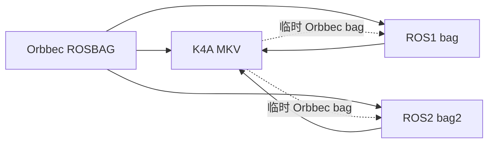

<h1 align="center">bag2mkv</h1>

<p align="center">
  <strong>在 Orbbec ROSBAG、Azure Kinect MKV 与 ROS 1/2 bag 之间做无损 RGB-D 转换。</strong>
</p>

<p align="center">
  <a href="README.md">English</a> ·
  <a href="README.zh-CN.md">简体中文</a>
</p>

<p align="center">
  
  
  
  
  
  
  
</p>

> **v0.6.0** — Windows x64 提供 CLI + GUI；Linux x86_64 提供 CLI。ROS 1/2 转换在两个平台的 CLI 中可用。
> GUI 仅支持 Windows。

`bag2mkv` 是一个专注、可验证的 RGB-D 录制转换工具。它不会重新编码彩色、不会滤波深度、不会强行对齐数据流，也不会把普通视频封装伪装成 Kinect 录制。它尽可能保留源数据，并提供一套可以独立验证结果的方法。

---

## 目录

- [为什么是 bag2mkv](#为什么是-bag2mkv)
- [转换矩阵](#转换矩阵)
- [无损契约](#无损契约)
- [快速开始](#快速开始)
- [命令行](#命令行)
- [ROS 1 / ROS 2](#ros-1--ros-2)
- [GUI](#gui)
- [架构](#架构)
- [格式说明](#格式说明)
- [验证](#验证)
- [限制与路线图](#限制与路线图)
- [常见问题](#常见问题)
- [参与贡献](#参与贡献)
- [许可证](#许可证)
- [仓库英文简介](#仓库英文简介)

---

## 为什么是 bag2mkv

Azure Kinect 录制（`.mkv`）和 Orbbec ROSBAG（`.bag`）都包含同步的彩色、深度、IR 与元数据，但它们使用完全不同的容器方言。常见转换工具通常选择“省事”的路线：全部解码成视频、丢掉深度精度，或者悄悄缩放图像。

`bag2mkv` 选择更麻烦但更可靠的路线：

- **彩色不重新编码。** 原始 MJPEG 字节保存在独立的 K4A 轨道中；BGRA 只是给需要兼容播放器的场景做确定性解码。
- **深度逐值保留。** 只做 K4A 必需的 16-bit 小端 → 大端表示转换。
- **元数据不丢。** 设备信息、stream profile、property、帧时间戳、帧号、原始 metadata 都写入 MKV attachment。
- **输出原子写。** 先写 `.tmp`，成功关闭后再 rename；失败不会留下半成品。
- **结果可独立验证。** `verify` 会重新比较源 bag 与生成的 MKV，而不是相信转换过程自己的计数。

整个过程不需要连接相机。`k4a_record_create(device = nullptr)` 就可以生成合法的 K4A 录制。

---

## 转换矩阵

| # | 输入 | 输出 | 命令 | 状态 |
|---|---|---|---|---|
| 1 | Orbbec ROSBAG `#ROSBAG V2.0` | K4A 兼容 MKV | `convert` | 可用 |
| 2 | K4A MKV | Orbbec ROSBAG | `mkv2bag` | 可用 |
| 3 | Orbbec ROSBAG | 标准 ROS1 `.bag` | `ros1` | 可用 |
| 4 | Orbbec ROSBAG | ROS2 sqlite3 bag 目录 | `ros2` | 可用 |
| 5 | 标准 ROS1 `.bag` | K4A 兼容 MKV | `ros1mkv` | 可用 |
| 6 | ROS2 sqlite3 bag 目录 | K4A 兼容 MKV | `ros2mkv` | 可用 |
| 7 | K4A MKV | ROS1 `.bag` | `mkv2ros1` | 可用 |
| 8 | K4A MKV | ROS2 sqlite3 bag 目录 | `mkv2ros2` | 可用 |

> `mkv2ros1` / `mkv2ros2` 目前会先经过一个临时 Orbbec bag。输出格式是正确的；多一次磁盘 I/O 只是实现细节，不是格式限制。

**暂不支持：** 任意 ROS 图像分辨率、IMU 流、ROS2 MCAP 存储。详见[限制与路线图](#限制与路线图)。

---

## 无损契约

| 数据 | 保证 | 实现 |
|---|---|---|
| 彩色 | 不做 JPEG/MPEG 重编码 | 原始 MJPEG 字节写入 `ORIGINAL_COLOR_MJPG`；BGRA 只是确定性解码 |
| 深度 | 16-bit 数值逐值一致 | 只由 K4A writer 做 LE → BE 字节序转换 |
| IR | 16-bit 数值逐值一致 | `mono16` / `16UC1` 写入 K4A `IR16` |
| 时间戳 | 微秒精度 | K4A device timestamp 使用 µs |
| 帧身份 | 保留 | `header.seq`、`frame_id`、帧 `number`、原始 metadata、`pixel_bit_size` |
| 设备元数据 | 尽可能保留 | MKV attachment：标定、profile、property、manifest/JSONL |
| 输出安全 | 不产生“看似成功”的半成品 | 写 `.tmp`；失败删除；成功后 rename |

### “无损”的边界

这里的无损指：**在支持的容器模式内，不重新编码像素、不改变深度数值**。K4A 只接受固定的彩色/深度分辨率；不匹配的输入会被明确拒绝，而不是静默缩放。

对于 JPEG 压缩的 ROS 彩色，`--color bgra` 会解码成 BGRA；如果连原始 JPEG 码流本身都要保留，请使用 `--color mjpg`。

---

## 快速开始

### Windows 发布包

从 [Releases](https://github.com/Erik-Lin/bag2mkv/releases) 下载最新的 Windows x64 压缩包，解压后运行：

```powershell
.\bag2mkv.exe --version
.\bag2mkv.exe --help
```

发布包已包含 K4A/Orbbec 运行库和 VC++ 运行库，不需要额外安装 Visual Studio。

### Linux 发布包

下载 Linux x86_64 CLI 包后运行：

```bash
tar -xzf bag2mkv-v0.6.0-linux-x86_64-cli.tar.gz
./bag2mkv-v0.6.0-linux-x86_64-cli/bin/bag2mkv --version
```

要求：x86_64 Linux、glibc 2.28+、libstdc++6。包内已带 Orbbec K4A Wrapper 动态库，并通过 wrapper 设置 `LD_LIBRARY_PATH`，不需要系统安装 K4A SDK。

### 从源码构建

依赖：

- Windows 10/11 x64
- Visual Studio 2022（MSVC）与 Windows 10/11 SDK
- CMake 3.16+
- 仓库自带的 `azurekinectsdk/`（头文件、`.lib`、运行时 DLL）

```powershell
cmake -S . -B build -G "Visual Studio 17 2022" -A x64
cmake --build build --config Release
ctest --test-dir build -C Release --output-on-failure
```

生成：

```text
build\Release\bag2mkv.exe
build\Release\bag2mkv-gui.exe
```

### Linux 从源码构建

依赖：

- x86_64 Linux、CMake 3.16+、GCC 9+ 或 Clang 10+
- Linux 版 Orbbec K4A Wrapper（头文件 + `.so`）

```bash
# 将 Linux SDK 解压到 ./k4a-wrapper
cmake -S . -B build-linux \
  -DCMAKE_BUILD_TYPE=Release \
  -DBUILD_GUI=OFF \
  -DK4A_ROOT="$PWD/k4a-wrapper"
cmake --build build-linux --parallel
ctest --test-dir build-linux --output-on-failure
```

输出：

```text
build-linux/bag2mkv
```

Linux 构建不包含 `bag2mkv-gui`。JPEG 解码使用 `stb_image`，SHA-256 使用内置实现，因此不依赖 WIC/BCrypt；运行时仍需要 Orbbec K4A Wrapper 的 `.so`，发布包已自动附带。

### 第一次转换

```powershell
# 查看 Orbbec bag 内容
.\build\Release\bag2mkv.exe inspect capture.bag

# Orbbec bag -> K4A MKV，保留原始 JPEG 并验证
.\build\Release\bag2mkv.exe convert capture.bag -o capture.mkv --color mjpg --verify

# K4A MKV -> Orbbec bag
.\build\Release\bag2mkv.exe mkv2bag capture.mkv -o capture_roundtrip.bag --force

# Orbbec bag -> 标准 ROS1 bag
.\build\Release\bag2mkv.exe ros1 capture.bag -o capture_ros1.bag --force

# Orbbec bag -> ROS2 sqlite3 bag
.\build\Release\bag2mkv.exe ros2 capture.bag -o capture_ros2 --force
```

---

## 命令行

```text
bag2mkv <command> [options]
bag2mkv help <command>
bag2mkv --version
bag2mkv --self-test
```

| 命令 | 用途 |
|---|---|
| `inspect <bag>` | 显示容器、设备、profile、property、帧数、时间戳 |
| `convert <bag> -o <mkv>` | Orbbec bag → K4A MKV |
| `batch <files-or-dir...> --output-dir <dir>` | 批量转换 |
| `verify <bag> <mkv>` | 独立验证帧、时间戳、标定 |
| `mkv2bag <mkv> -o <bag>` | K4A MKV → Orbbec bag |
| `ros1 <bag> -o <bag>` | Orbbec bag → 标准 ROS1 bag |
| `ros1mkv <bag> -o <mkv>` | 标准 ROS1 bag → K4A MKV |
| `ros2 <bag> -o <dir>` | Orbbec bag → ROS2 sqlite3 bag |
| `ros2mkv <dir> -o <mkv>` | ROS2 sqlite3 bag → K4A MKV |
| `mkv2ros1 <mkv> -o <bag>` | K4A MKV → ROS1 bag |
| `mkv2ros2 <mkv> -o <dir>` | K4A MKV → ROS2 sqlite3 bag |

每个命令都有详细帮助：

```powershell
.\build\Release\bag2mkv.exe help convert
.\build\Release\bag2mkv.exe help batch
.\build\Release\bag2mkv.exe help mkv2bag
.\build\Release\bag2mkv.exe help ros1
.\build\Release\bag2mkv.exe help ros2
```

常用选项：

```text
--color bgra|mjpg       彩色表示（默认 bgra）
--no-original-color     BGRA 模式下省略 ORIGINAL_COLOR_MJPG
--no-calibration        不写 calibration.json
--calibration-json FILE 使用已知正确的 K4A 标定
--force                 覆盖已有输出
--verify                convert 后立即验证
```

退出码：`0` 成功，`1` 转换/验证失败，`2` 用法错误，`3` 用户取消。

---

## ROS 1 / ROS 2

ROS 转换是**格式层**实现：转换机器不需要安装 ROS、`rosbag`、`rosbag2_cpp` 或 `rclcpp`。

### Topic 与消息类型

| Topic | 消息 | 数据 |
|---|---|---|
| `/camera/color/image_raw/compressed` | `sensor_msgs/CompressedImage` | 原始 JPEG，`format: jpeg` |
| `/camera/color/image_raw` | `sensor_msgs/Image` | 原始彩色（如 `rgb8`、`bgr8`、`bgra8`） |
| `/camera/depth/image_raw` | `sensor_msgs/Image` | `16UC1`，小端 |
| `/camera/ir/image_raw` | `sensor_msgs/Image` | `16UC1`，小端 |

### ROS1 输出

`ros1` 写出标准 ROSBAG V2.0，包含：

- ROS1 要求的拆分 connection 记录（`op=7`）；
- 每个 connection 的 index data（`op=4`）；
- chunk-info 记录（`op=6`）；
- message header 和 chunk header 中的 ROS time 字段。

输出可以被标准 ROS1 工具以及 `rosbags.rosbag1.Reader` 读取。

### ROS2 输出

`ros2` 生成标准 rosbag2 目录：

```text
capture_ros2/
├─ metadata.yaml
└─ bag_0.db3
```

消息使用 CDR 序列化的 `sensor_msgs/msg/Image` 与 `sensor_msgs/msg/CompressedImage`。SQLite 驱动已随仓库 vendor，不需要系统 SQLite。

### 分辨率限制

K4A 只支持以下模式：

| 流 | 支持尺寸 |
|---|---|
| 彩色 | 1920×1080、1280×720、3840×2160、2560×1440、2048×1536、4096×3072 |
| 深度 / IR | 640×576、320×288、512×512、1024×1024 |

其他尺寸的 ROS bag 会被明确拒绝。`bag2mkv` 不会静默缩放或裁剪。

这对常见 RealSense 录制很重要：640×480 彩色 / 1280×720 深度的 bag 是合法 ROS1 bag，但不能直接表示成 K4A MKV。默认不启用有损缩放模式。

### ROS 路径的无损说明

- **Orbbec → ROS1/ROS2：** 压缩彩色保留原始 JPEG 字节；原始彩色和深度不做转码。
- **ROS1/ROS2 → K4A MKV：** `--color mjpg` 保留 `CompressedImage` 的 JPEG 字节；默认 `--color bgra` 会解码成 BGRA。
- **CameraInfo：** 当前不会转换成 K4A 标定；ROS 来源的 MKV 可能被 K4A playback 提示缺少标定。
- **ROS2 存储：** 支持 sqlite3；暂不支持 MCAP。

### K4A MKV → ROS

```powershell
.\build\Release\bag2mkv.exe mkv2ros1 capture.mkv -o capture_ros1.bag --force
.\build\Release\bag2mkv.exe mkv2ros2 capture.mkv -o capture_ros2 --force
```

这两个命令会先用 `mkv2bag` 重建临时 Orbbec bag，再调用对应导出器。这样复用了已验证的反向路径并保留全部图像数据，代价是多一次临时文件 I/O。

---

## GUI

`bag2mkv-gui.exe` 是原生 Win32 GUI，不是网页套壳。

```text
输入目录  +  输出目录  +  开始转换
```

- 递归扫描 `.bag` / `.mkv`。
- 自动判断方向：全是 bag → MKV；全是 MKV → Orbbec bag。
- 目录中同时有两种格式会直接报错。
- 子目录结构会镜像到输出目录。
- 单个文件失败不会中断其余文件；进度、取消、日志都在窗口内。
- 支持覆盖确认、转换后自动验证、彩色模式。

GUI 目前只覆盖 **Orbbec bag ↔ K4A MKV**；ROS 转换在 v0.6.0 中仅 CLI 可用。

```powershell
.\build\Release\bag2mkv-gui.exe
.\build\Release\bag2mkv-gui.exe <输入目录> <输出目录> --start
.\build\Release\bag2mkv-gui.exe --batch <输入目录> --batch-output <输出目录> --mjpg
.\build\Release\bag2mkv-gui.exe --to-bag <input.mkv> --to-bag-output <output.bag>
```

---

## 架构



核心是纯 C++17，CLI 与 GUI 共用：

```text
src/
  bag.cpp / bag_writer.cpp     Orbbec ROSBAG 读写
  k4a_writer.cpp               K4A 录制写入
  converter.cpp                共享扫描 / 转换 / 验证管线
  mkv2bag.cpp                  K4A playback → Orbbec bag
  ros1_export.cpp              Orbbec bag → 标准 ROS1 bag
  ros1_input.cpp               标准 ROS1 bag → K4A MKV
  ros2_export.cpp              Orbbec bag → ROS2 sqlite3/CDR
  ros2_input.cpp               ROS2 sqlite3/CDR → K4A MKV
  gui_win32.cpp                原生 Windows GUI
third_party/                   LZ4、bzip2、SQLite
```

更细的格式约束和开发说明见 [AGENTS.md](AGENTS.md)。

---

## 格式说明

### Orbbec ROSBAG

Orbbec `.bag` 的魔数也是 `#ROSBAG V2.0`，但它**不是**普通 ROS bag：

- connection 记录拆成两个 header；
- message 记录没有 `data=` 字段；
- chunk 支持 LZ4、BZ2、未压缩；
- chunk header 里的 `size` 不一定是真实解压长度。

这些细节由原生 reader 处理。

### K4A MKV

K4A 录制是带 Kinect 专用 track/tag 的 Matroska 容器，不是普通视频：

- `COLOR` — BGRA 或 MJPEG；
- `DEPTH` — `b16g`，文件内大端；
- `IR` — `IR16`；
- `ORIGINAL_COLOR_MJPG` — 可选，保存原始 JPEG 字节；
- attachment — 标定、manifest、逐帧 JSONL、原始 profile/property blob。

### ROS

- ROS1：标准 ROSBAG V2.0，带 index data 和 chunk info。
- ROS2：`metadata.yaml` + `bag_0.db3`，CDR 序列化。

---

## 验证

```powershell
# 内置快速检查
.\build\Release\bag2mkv.exe --self-test
ctest --test-dir build -C Release --output-on-failure

# 逐帧验证转换结果
.\build\Release\bag2mkv.exe verify capture.bag capture.mkv
```

`verify` 会检查：

- 彩色像素与确定性 JPEG 解码结果；
- 原始 JPEG 与源 bag 的 SHA-256；
- 深度在大端 → 小端转换后的数值；
- 设备时间戳；
- 帧数与流长度；
- 存在 `calibration.json` 时的内参。

当前测试包括 10 个 CTest 用例、合成 Orbbec/ROS 样本，以及独立 `rosbags` 生成的 ROS2 CDR fixture。真实设备录制仍建议在最终消费数据的机器上再验证一次。

---

## 限制与路线图

### 已知限制

- **GUI 仅支持 Windows。** CLI（包括 ROS1/ROS2 转换）在 Windows 和 Linux 上都可用。
- **Linux 只有 CLI。** 没有 Linux GUI；原生 Win32 GUI 不跨平台。
- **GUI 不暴露 ROS。** v0.6.0 中 ROS 1/2 仅 CLI。
- **没有任意分辨率模式。** K4A 固定模式是硬约束，不做隐式 resize/crop。
- **暂不做 CameraInfo → K4A 标定合成。** ROS 来源的 MKV 可能缺少标定。
- **暂不支持 IMU 流。**
- **ROS2 仅支持 sqlite3。** 暂不支持 MCAP。
- **`mkv2ros1/2` 使用临时 Orbbec bag。** 结果正确，但比直接 K4A playback 导出慢。
- **Linux 运行依赖。** 预编译 Linux CLI 面向 x86_64、glibc 2.28+、libstdc++6；K4A/Orbbec 库已随包提供。

### 路线图

- [ ] 原生 Linux 包（`.deb`、AppImage）与更多发行版测试。
- [ ] K4A playback 直接导出 ROS1/ROS2，去掉临时 bag。
- [ ] GUI 增加 ROS1/ROS2 方向。
- [ ] 可选的显式 `--allow-resize`，用于非 K4A 分辨率的 ROS 输入，并明确标记有损。
- [ ] CameraInfo → K4A 标定合成。
- [ ] IMU track 支持。
- [ ] 更多真实设备往返测试。

---

## 常见问题

### 真的无损吗？

在支持的模式内：彩色不重编码、深度/IR 逐值一致、元数据保留。JPEG 压缩的 ROS 输入默认会解码为 BGRA；要保留 JPEG 码流请用 `--color mjpg`。K4A 固定分辨率是硬约束，不是质量选项。

### 为什么默认输出这么大？

BGRA 1080p 每帧彩色约 8.3 MB，再加深度；45 秒录制超过 12 GB 很正常。播放器支持 MJPG 时可用 `--color mjpg` 得到小得多的 K4A 文件。

### 需要连接 Azure Kinect 吗？

不需要。writer 用空设备创建录制，图像来自源 bag。

### 需要安装 ROS 吗？

不需要。ROS1/ROS2 容器由 `bag2mkv` 直接读写。

### 能把 RealSense ROS1 bag 转成 MKV 吗？

只有尺寸匹配 K4A 模式时才可以。640×480 / 1280×720 的 RealSense 录制会被明确拒绝，不会静默缩放。

### 支持 BZ2 吗？

支持。`compression=bz2` 的 Orbbec chunk 使用 vendored bzip2 1.0.8 解压。

### 能在 Linux 上运行吗？

可以，CLI 支持 x86_64 Linux。使用 Linux CLI 包，或在 Linux 上以 `-DBUILD_GUI=OFF` 构建；GUI 仍然只支持 Windows。预编译包要求 glibc 2.28+、libstdc++6，并已附带 Orbbec K4A 库。

---

## 参与贡献

欢迎各种贡献：bug 报告、真实设备录制（需有权限）、播放器兼容性反馈、格式文档和测试。

- 提交 PR 前请阅读 [CONTRIBUTING.md](CONTRIBUTING.md)。
- 修改格式相关代码前请阅读 [AGENTS.md](AGENTS.md) 中的无损契约。
- 不要在 issue/PR 中上传测试录制；请提供最小复现和日志。
- 每个 PR 只做一件事。

适合入手的方向：Linux 打包/发行版测试、ROS CameraInfo/标定、K4A → ROS 直接导出、更多播放器兼容性测试。

---

## 许可证

MIT License，版权归 **林山力** 所有。

- [LICENSE](LICENSE)
- LZ4：[third_party/lz4/LICENSE](third_party/lz4/LICENSE)
- bzip2：[third_party/bzip2/COPYING](third_party/bzip2/COPYING)
- SQLite：[third_party/sqlite/README.txt](third_party/sqlite/README.txt)
- stb_image：[third_party/stb/LICENSE.txt](third_party/stb/LICENSE.txt)
- Orbbec K4A 运行时：遵循上游 Orbbec SDK 的许可/条款。

---

## 仓库英文简介

**GitHub About（短）：**

> Lossless RGB-D conversion between Orbbec ROSBAG, Azure Kinect MKV, and ROS 1/2 bags — with a Windows CLI and GUI.

**长简介：**

> `bag2mkv` is a lossless, verifiable RGB-D conversion toolkit. It converts Orbbec ROSBAG recordings to Azure Kinect-compatible MKV, rebuilds Orbbec bags from K4A MKV, and imports/exports standard ROS1 and ROS2 bags. It preserves original JPEG color, bit-exact depth, timestamps, and device metadata, and includes an independent verifier. The Windows release ships both a CLI and a native GUI; ROS conversion is available from the command line.

英文版见 [README.md](README.md)。
